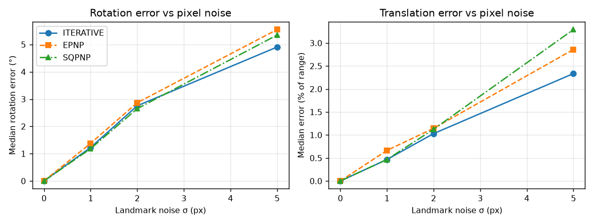
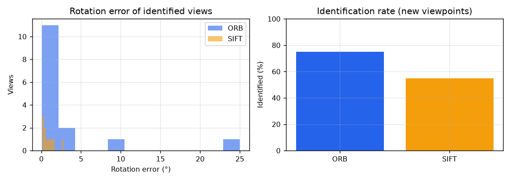
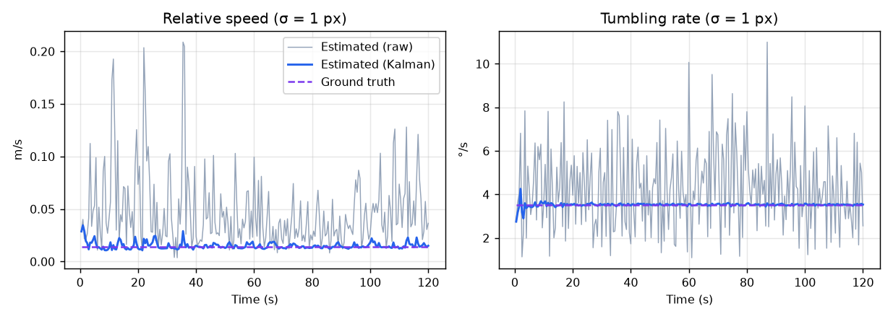
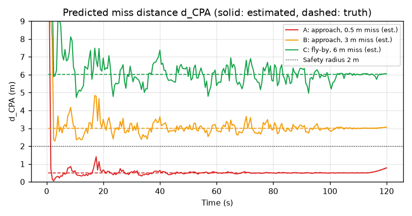

# Evaluation results

Generated by `python tests/evaluate_pipeline.py` on 2026-11-17 16:25
(101 s). Every number is measured by running the project code against exact simulation
ground truth (fixed random seeds, reproducible). Image size 1600×900 px, vertical FOV 60°.

## 1. YOLOv8n detection
Values from the training log `runs/satellite_yolov8n_v1/results.csv` at the best epoch (validation set: 40 images).
The separate Ultralytics final validation of best.pt reports 95.16% / 88.43% / 96.87% / 76.10% (rounding differences only).

| Metric | Value |
|---|---|
| Training epochs (best epoch) | 50 (50) |
| Precision | 95.16% |
| Recall | 88.47% |
| mAP@50 | 96.87% |
| mAP@50-95 | 76.09% |
| Inference time (CPU) | 74.2 ms mean / 74.3 ms median over 40 val images |

## 2. 6-DoF pose from 2D-3D landmark correspondences
150 random target poses at 1-10 m, 9 landmarks, Gaussian pixel noise σ added to the 2D points.

| Solver | σ (px) | Success | Rot. err median (°) | Rot. err max (°) | Trans. err median (% range) | RMSE (px) | Time (ms) |
|---|---|---|---|---|---|---|---|
| ITERATIVE | 0.0 | 100.0% | 0.0 | 0.0 | 0.0 | 0.0 | 0.202 |
| ITERATIVE | 1.0 | 100.0% | 1.227 | 7.131 | 0.467 | 1.149 | 0.331 |
| ITERATIVE | 2.0 | 100.0% | 2.7545 | 10.156 | 1.03 | 2.164 | 0.348 |
| ITERATIVE | 5.0 | 100.0% | 4.906 | 24.852 | 2.335 | 5.564 | 0.462 |
| EPNP | 0.0 | 100.0% | 0.0 | 0.0 | 0.0 | 0.0 | 0.125 |
| EPNP | 1.0 | 100.0% | 1.379 | 7.138 | 0.665 | 1.252 | 0.121 |
| EPNP | 2.0 | 100.0% | 2.867 | 15.39 | 1.144 | 2.332 | 0.122 |
| EPNP | 5.0 | 100.0% | 5.5465 | 40.231 | 2.859 | 5.974 | 0.121 |
| SQPNP | 0.0 | 100.0% | 0.0 | 0.0 | 0.0 | 0.0 | 0.06 |
| SQPNP | 1.0 | 100.0% | 1.1835 | 7.266 | 0.468 | 1.153 | 0.106 |
| SQPNP | 2.0 | 100.0% | 2.649 | 10.063 | 1.124 | 2.175 | 0.124 |
| SQPNP | 5.0 | 100.0% | 5.345 | 36.561 | 3.292 | 5.726 | 0.152 |

## 3. Feature-based pose and target identification (ORB vs SIFT)
Reference library: 24 views rendered from satellite.glb at 1.2 m (30° yaw steps, two pitch angles);
33223 ORB / 7504 SIFT keypoints lifted to 3D.
Test: 20 NEW random viewpoints (1.0-1.6 m, roll ±20°) + 5 empty star-field frames.

| Feature | Test views | Identified | False IDs (empty frames) | Median inliers | Rot. err median (°) | Rot. err 90th pct (°) | Trans. err median (% range) | Time (ms) |
|---|---|---|---|---|---|---|---|---|
| ORB | 20 | 75.0% | 0/5 | 47.0 | 0.889 | 6.064 | 0.434 | 325.4 |
| SIFT | 20 | 55.0% | 0/5 | 15.5 | 0.683 | 1.474 | 0.243 | 195.2 |

## 4. Multi-frame tracking (SORT: Kalman + IoU + Hungarian)
400 frames of a moving target box with 3 px jitter; detections randomly missed / spurious boxes added.

| Missed detections | False positives | Frames | Frames tracked | ID switches | ID consistency |
|---|---|---|---|---|---|
| 0% | 0% | 400 | 399 | 0 | 100.0% |
| 0% | 5% | 400 | 399 | 0 | 100.0% |
| 10% | 0% | 400 | 357 | 0 | 100.0% |
| 10% | 5% | 400 | 357 | 0 | 100.0% |
| 30% | 0% | 400 | 292 | 0 | 100.0% |
| 30% | 5% | 400 | 270 | 0 | 100.0% |

## 5. Relative motion estimation (Kalman filter vs raw finite differences)
Target drifting at |v| = 0.0140 m/s and tumbling at 3.53 °/s, chaser camera slewing to
follow it, 120 s at 2 Hz. RMSE after 10 s convergence.

| Landmark noise σ | Range RMSE (m) | Speed RMSE raw (m/s) | Speed RMSE Kalman (m/s) | Tumble RMSE raw (°/s) | Tumble RMSE Kalman (°/s) |
|---|---|---|---|---|---|
| 0.5 px | 0.0102 | 0.0194 | 0.0012 | 1.097 | 0.027 |
| 1.0 px | 0.0205 | 0.0492 | 0.0029 | 2.072 | 0.037 |
| 2.0 px | 0.0452 | 0.1168 | 0.0066 | 4.601 | 0.076 |

## 6. Collision risk (TTC / CPA, safety radius 2 m, horizon 60 s)
Target approaching at 0.08 m/s from 9 m with different miss distances, σ = 1 px.

| Scenario | Steps | Risk level agreement | Truth risk | First HIGH (est.) | First HIGH (truth) | d_CPA error median (m) |
|---|---|---|---|---|---|---|
| A: approach, 0.5 m miss | 240 | 91.7% | HIGH | 35.5 s | 52.5 s | 0.019 |
| B: approach, 3 m miss | 240 | 95.4% | MEDIUM | -- | -- | 0.147 |
| C: fly-by, 6 m miss | 240 | 100.0% | LOW | -- | -- | 0.330 |

## Limitations
- All images are rendered from the 3D model in the simulator; no real space imagery was used.
- Landmark-based pose uses simulated (projected) keypoints with added noise; ORB/SIFT pose uses real image
  features on rendered frames.
- The tracking test uses synthetic detection boxes; tracking on live YOLO detections is shown in the app.
